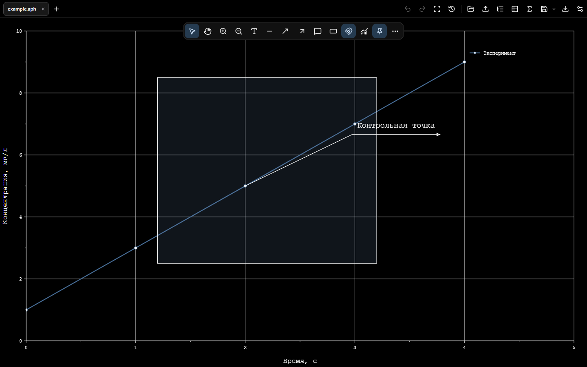

<div align="center">

# APIO GRAPH

**Scientific data. Precise graphs.**


**Free, open-source scientific plotting and data analysis software for Windows.** Import X–Y measurements from CSV, TXT or TSV files, process signals, fit peaks and export scientific graphs as SVG, PNG or JPEG. APIO GRAPH runs locally, without an account or cloud service.

**[Download for Windows x64](https://github.com/anatamien/APIO-GRAPH-/releases/latest)** · [All releases](https://github.com/anatamien/APIO-GRAPH-/releases) · [Report a bug](https://github.com/anatamien/APIO-GRAPH-/issues/new/choose)

[Русский](README.ru.md) · [User guide](docs/USER_GUIDE.md) · [Release notes](CHANGELOG.md) · [Contributing](CONTRIBUTING.md)

</div>


## Scientific plotting workflows

APIO GRAPH is a desktop graphing tool for students, researchers and engineers working with numerical X–Y data. It supports these workflows:

- **Plot data from CSV, TXT or TSV:** import measured X–Y columns, manage multiple curves and adjust axes, markers, labels and legends.
- **Fit and inspect peaks:** fit supported Gaussian, Lorentzian and pseudo-Voigt profiles; inspect components and residuals. See [peak-fitting methods and limitations](docs/13-PEAK-FITTING-AND-STYLES.md).
- **Process experimental signals:** use baseline correction, peak detection, integration, smoothing with Savitzky–Golay, regression and other numerical operations. See [signal-analysis methods](docs/10-SIGNAL-ANALYSIS.md).
- **Prepare graphs for reports and publications:** customize scientific labels, uncertainties and annotations, then export vector SVG or raster PNG/JPEG with size and DPI settings, including monochrome output.

For some 2D plotting and analysis tasks, APIO GRAPH may serve as a free, open-source alternative to OriginLab Origin or OriginPro. **It is not a feature-complete Origin replacement.** Viewing and transferring Origin content is experimental and limited to documented supported objects; see [Origin compatibility](docs/11-ORIGIN-COMPATIBILITY.md).

## Features

- **1.3.5 document workflow**: marquee selection and shared object movement, mixed-object edge/center and equal-gap guides, double-click drawing properties, safe cell-range Delete and unbounded blank-sheet navigation with F9.

- **Data and results**: source/derived dependencies, editable processing parameters and targeted recalculation with independent curve styles.
- **New in 1.3**: bounded Gaussian/Lorentzian/pseudo-Voigt peak fitting, independent components and residuals, symmetric X/Y uncertainties, portable scientific appearance presets. [Methods and limits](docs/13-PEAK-FITTING-AND-STYLES.md).
- Signal analysis: manual/polynomial/AsLS baseline correction, peak tables and interactive signed integration. [Methods and limits](docs/10-SIGNAL-ANALYSIS.md).
- A common portable `.aph` saves all open APIO and Origin tabs, with exact binary measurement buffers, per-tab editing and original Origin bytes. [Format and compatibility](docs/12-APH-WORKSPACE.md).
- Editable diagram tables, scientific symbols and rich subscripts/superscripts; compact table-size picker and draggable row/column boundaries.
- Experimental Origin viewer: typed worksheets/matrices, resolved 2D XY pages with layers, column-to-graph hints and explicit transfer to editable APIO graphs. Unsupported objects remain archived. [Scope and limits](docs/11-ORIGIN-COMPATIBILITY.md).
- Import TXT/CSV/TSV, paste tables or enter measurements manually. Independent graph tabs with explicit data append.
- Edit axes, series, markers and the legend; add text, subscripts/superscripts, arrows, callouts and regions.
- Regression, Savitzky–Golay filtering, moving averages, differentiation, integration, interpolation and statistics. Source measurements and derived results remain separate.
- Pan, zoom with the wheel and fit all content with F9. Screen rendering uses level of detail; calculations and exports retain original measurements.
- Export SVG/PNG/JPEG with dimensions, DPI and colour controls, including black-and-white output.
- Save complete `.aph` projects and multi-tab workspaces, with data, calculations, annotations and styling. Per-graph undo/redo and local recovery.
- English/Russian; light, True Black and system themes. Local processing without an account or a cloud service.

Open **Graph properties → Data and results** to follow each dataset through its operations. Select a row for its source, parameters and numerical summary; its menu opens properties, changes processing parameters or removes a branch with confirmation. Editing a source marks only its dependent results outdated. Recalculation preserves styling, visibility and the current view. The tree's add command appends to the current graph; the top **+** opens an independent graph tab.

<details>
<summary>True Black theme</summary>



</details>

## Install on Windows

Download `APIO-GRAPH-1.3.5-windows-x64-offline-setup.exe` from [Releases](https://github.com/anatamien/APIO-GRAPH-/releases/latest) and run it. Choose English or Russian. The installer installs for the current user, adds a Start menu entry and registers `.aph` projects.

The Microsoft WebView2 offline installer is included. End users do not need to separately download WebView2, Node.js, Rust, Visual Studio or development tools. Initial installation can run without internet access. The distribution target is **Windows 10/11 x64**; this is not a Windows 7, ARM64 or macOS installer. Enterprise policies can restrict software installation.

This release is **not Authenticode-signed**. Windows may display an unknown-publisher or SmartScreen prompt. Verify file integrity against `SHA256SUMS.txt` from the same release; a checksum is not a publisher signature.

```powershell
Get-FileHash .\APIO-GRAPH-1.3.5-windows-x64-offline-setup.exe -Algorithm SHA256
```

Your datasets, `.aph` documents and exported figures remain yours. The application's code license does not apply to your scientific data.

## Frequently asked questions

**Is APIO GRAPH free and open source?** Yes. The application source code is published under GPL-3.0-only. There is no account, subscription or cloud service required to use the Windows installer.

**Can I plot CSV data and export publication figures?** Yes. APIO GRAPH imports TXT/CSV/TSV numerical data and exports customizable SVG, PNG and JPEG graphs. Review the exported figure and any journal-specific requirements before submission.

**Can I use it for X-ray diffraction (XRD) or spectroscopy plots?** You can plot X–Y measurements exported as supported text or table data, and apply the documented peak and signal-analysis operations. APIO GRAPH does not claim instrument-specific raw-file decoding or automatic phase identification.

**Can it open Origin or OriginPro projects?** Experimental Origin viewing and partial transfer are available for supported content. Unsupported objects and formats remain limited; complete visual or analytical compatibility is not guaranteed. See [the compatibility details](docs/11-ORIGIN-COMPATIBILITY.md).

**Does it run on macOS or Linux?** The published 1.3.5 installer is for Windows 10/11 x64 only. A tested macOS or Linux release is not provided.

## Build from source

Development requires Node.js 24, pnpm 11, Rust and the [Tauri prerequisites](https://v2.tauri.app/start/prerequisites/). On Windows install Microsoft C++ build tools; the checked Rust toolchain is 1.99.1. Run commands in the directory containing `package.json` and `src-tauri`:

```sh
pnpm install --frozen-lockfile
pnpm tauri dev
```

Build the offline installer **on Windows x64**:

```sh
pnpm tauri build --ci --bundles nsis -- --locked
```

Output: `src-tauri/target/release/bundle/nsis/`. The build machine needs internet access to obtain dependencies, NSIS and the Microsoft runtime. End users do not need those downloads.

The source includes a macOS target. A currently verified, signed/notarized macOS 1.3.5 distribution is not provided; Windows release acceptance does not establish macOS compatibility.

## Verification

```sh
pnpm typecheck
pnpm lint
pnpm test
pnpm test:e2e
pnpm build
cargo test --manifest-path src-tauri/Cargo.toml --locked
pnpm check:repository
```

Windows UI checks use installed Microsoft Edge. For another supported test browser, set `PLAYWRIGHT_CHANNEL` and install that browser first. Browser-preview checks do not replace native WebView2 verification.

## Structure

| Directory | Purpose |
|---|---|
| `src/` | Interface, data model, numerical operations and rendering |
| `src-tauri/` | Native file handling, window and installer configuration |
| `schemas/` | `.aph` schema |
| `examples/` | Self-contained example projects |
| `tests/` | Unit, integration and UI checks |
| `docs/` | User documentation and dependency notices |

## License

Copyright © 2026 anatamien. **GNU General Public License v3.0 only**; see [LICENSE](LICENSE). Contributions are accepted under the same license.

Dependencies retain their own licenses: [notices](docs/THIRD_PARTY_NOTICES.md), [original texts](docs/licenses/README.md). Microsoft WebView2 is a separately licensed Microsoft component distributed through its unmodified offline installer. System fonts are not redistributed.
