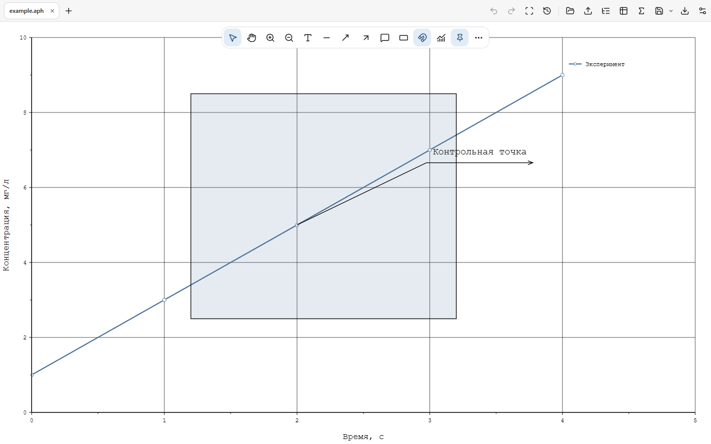

# APIO GRAPH

Настольный редактор научных графиков: импорт данных, математическая обработка, оформление и экспорт. Работа локальная, без регистрации и облачного сервера.

[English](README.md) · [Руководство](docs/USER_GUIDE.md) · [Изменения](CHANGELOG.md) · [GPLv3](LICENSE)

**[Скачать для Windows x64](https://github.com/anatamien/APIO-GRAPH-/releases/latest)** · [Сообщить об ошибке](https://github.com/anatamien/APIO-GRAPH-/issues/new/choose)

## Возможности

- Экспериментальный просмотр Origin: таблицы, матрицы, поддержанные страницы XY и перенос в редактируемые графики APIO. Исходный проект и неподдержанные фрагменты сохраняются. [Область поддержки и ограничения](docs/11-ORIGIN-COMPATIBILITY.md).
- В исходниках версии 1.2: ручная/полиномиальная коррекция фона и AsLS, поиск пиков с таблицей характеристик, интерактивное интегрирование со знаком. [Методы и ограничения](docs/10-SIGNAL-ANALYSIS.md).
- TXT/CSV/TSV, вставка таблицы и ручной ввод. Независимые графики во вкладках и явное добавление к текущему графику.
- Оси, линии, точки и легенда; текст с индексами, стрелки, выноски и области.
- Регрессии, Савицкий — Голей, скользящее среднее, производная, интеграл, интерполяция и статистика. Исходные измерения сохраняются отдельно от результатов.
- Панорамирование, масштабирование колесиком и F9. Оптимизация экрана сохраняет исходные данные для вычислений и экспорта.
- SVG/PNG/JPEG с управлением размером, DPI и цветами, включая строгий черно-белый режим.
- Полные проекты `.aph`, история изменений и восстановление работы.
- RU/EN, светлая, True Black и системная темы.

Откройте **Свойства графика → Данные и результаты**, чтобы увидеть связи исходных наборов, операций и расчетных кривых. Строка показывает источник, параметры и численный итог; меню открывает свойства, параметры обработки или удаление ветви с подтверждением. После изменения исходных измерений устаревают только зависимые результаты. Пересчет сохраняет оформление, видимость и текущий масштаб. Добавление в дереве дополняет текущий график, верхний **+** открывает независимую вкладку.

## Новое в 1.3.2

- Выделение объектов рамкой, совместное перемещение и общие привязки с подсказками одинаковых промежутков.
- Настройки всех графических объектов открываются двойным щелчком; один щелчок оставлен для выделения и копирования.
- Delete очищает выделенные ячейки без удаления таблицы. Пустой лист поддерживает свободное панорамирование/масштабирование, F9 и размещение объектов за исходными границами.
- Панель инструментов не перекрывает список вкладок; разделы свойств оформлены единообразно.

### Возможности 1.3

- Гаусс, Лоренц и псевдо-Фойгт: ограниченный подбор перекрывающихся пиков в Worker, независимые компоненты и остатки, воспроизводимый пересчет.
- Абсолютные симметричные ΔX/ΔY: импорт колонок, ручная таблица, постоянные значения для серии, полные интервалы при экспорте.
- Четыре научных стиля, свои переносимые шаблоны и копирование оформления без изменения измерений.
- Редактирование прямо в ячейках, диапазоны и объединение, числовой формат, копирование между вкладками, Undo/Redo, выравнивание таблиц при перемещении.
- Пустые листы, отправка копии объекта во вкладку, переименование вкладок двойным щелчком, вставка символов в подписи осей.

[Методы и ограничения 1.3](docs/13-PEAK-FITTING-AND-STYLES.md). Старые `.aph` продолжают открываться; проект с возможностями 1.3 требует обновленной версии приложения.

## Установка

На странице **Releases** скачайте `APIO-GRAPH-1.3.2-windows-x64-offline-setup.exe`. Установщик предложит русский или английский язык, установит приложение для текущего пользователя, добавит ярлык в меню «Пуск» и привязку `.aph`.

Microsoft WebView2 включен в установщик. Отдельно скачивать WebView2, Node.js, Rust или инструменты разработки не нужно; первоначальная установка поддерживает работу без интернета. Целевая платформа — Windows 10/11 x64. Это не сборка для Windows 7, ARM64 или macOS. Корпоративные ограничения могут запрещать установку приложений.

Сборка **без цифровой подписи Authenticode**: Windows может показать предупреждение о неизвестном издателе или SmartScreen. Контрольная сумма `SHA256SUMS.txt` в релизе проверяет целостность файла и не заменяет подпись издателя.

## Разработка и лицензия

Инструкции сборки — в [README](README.md#build-from-source). Для разработки нужны Node.js 24, pnpm 11, Rust и инструменты Tauri. Пользователям установщика эти инструменты не нужны.

Исходный код распространяется под **GPL-3.0-only**. При распространении производной версии необходимо соблюдать GPLv3, включая предоставление соответствующих исходников. На ваши измерения, проекты и экспортированные изображения лицензия приложения не распространяется. Сторонние компоненты сохраняют собственные лицензии.
